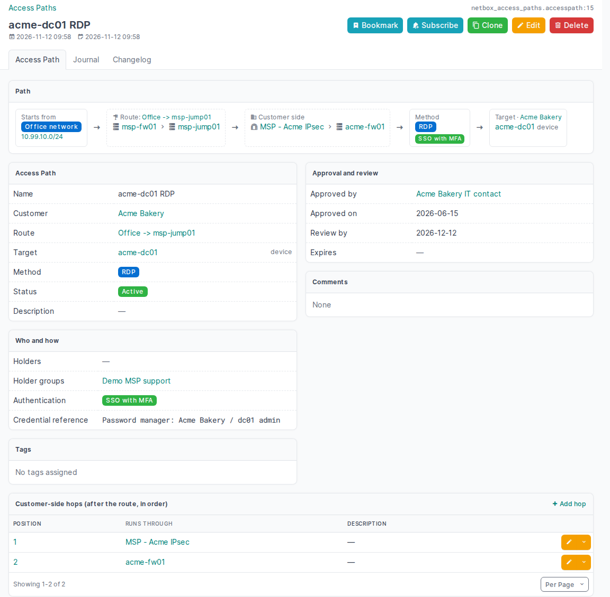
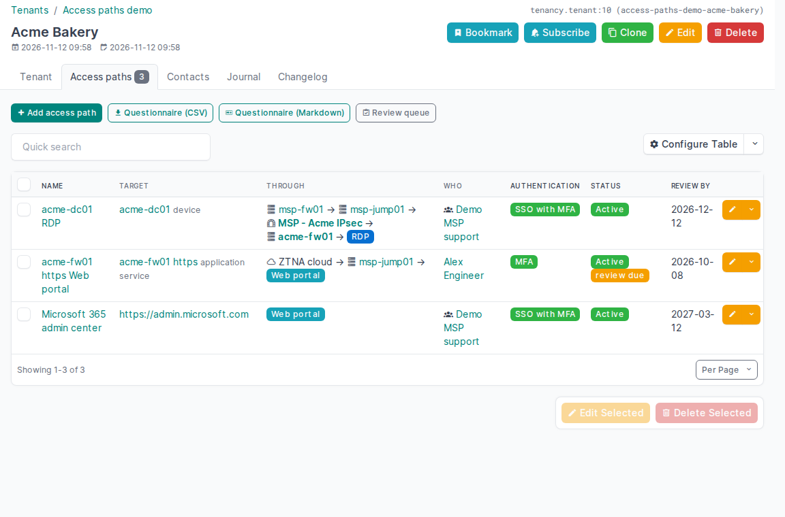
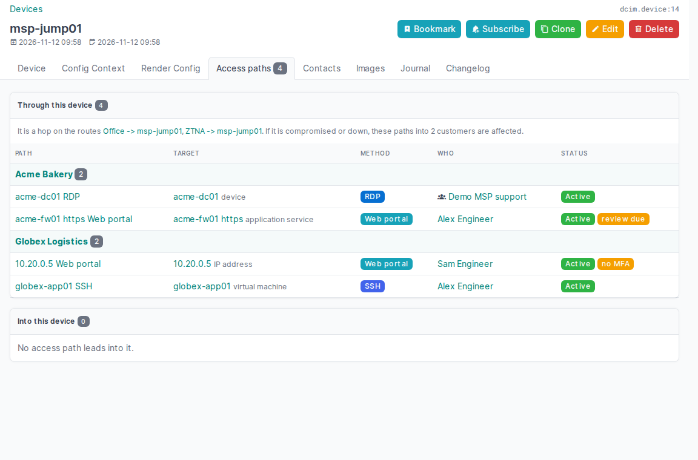
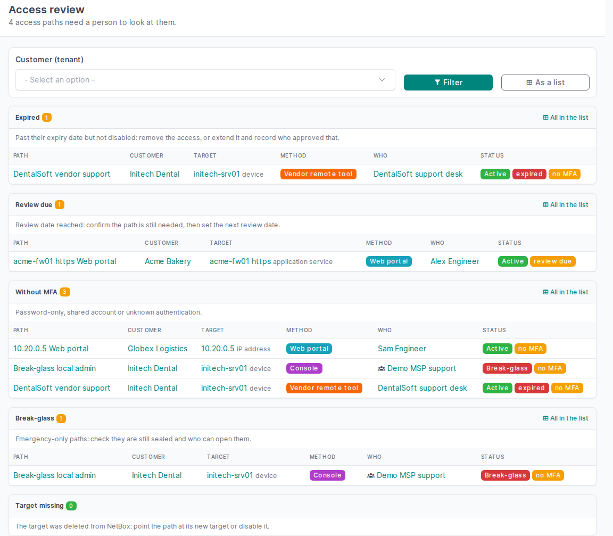

# netbox-access-paths

[](https://pypi.org/project/netbox-access-paths/)
[](https://pypi.org/project/netbox-access-paths/)
[](https://github.com/netbox-community/netbox)
[](https://github.com/Packetflow-be/netbox-access-paths/actions/workflows/ci.yml)
[](LICENSE)
[](https://pypi.org/project/netbox-access-paths/)

**Document how your team reaches every customer system, in NetBox.**

Every MSP has the same tribal knowledge: *to get into customer X, connect to the
office VPN, RDP to the jump host, then open the firewall portal.* It lives in a
wiki page, a password manager note, or one engineer's head. That's fine until:

- a customer's NIS2 supplier questionnaire asks *how exactly do you access our systems?*
- a technician leaves and you need to know everything they could reach,
- your jump host or RMM is compromised and you need to know which customers sit behind it,
- a new hire needs a map of how to get into customer infrastructure.

`netbox-access-paths` turns that knowledge into data. An **access path** is who can reach
which customer system, from where, through which hops, with which method, approved by
whom, and when it's due for review.

```
 Support team ──► Office LAN ──► NetBird ──► jump01 (VM) ──► RDP ──► customer-dc01
   (who)          (origin)       └────── shared route ─────┘  (method)  (target, tenant "Acme")
```



## What you get

- **Routes**: the MSP-side chain you reuse for every customer (office → VPN/ZTNA → jump host).
  Define it once; dozens of paths share it.
- **Paths**: route + customer-side hops + target (device, VM, service or URL) + method
  (RDP, SSH, web portal, RMM, vendor remote tool, ...), who may use it, MFA, and where the
  credential lives (a reference, never the secret).
- **Approval and review**: approved by, review date, expiry for temporary or vendor access,
  break-glass paths flagged.
- **Answers, not just records**:
  - *Customer tab*: every way into this tenant, ready to paste into a questionnaire (CSV/Markdown export).
  - *Device/VM tab*: every path that runs **through** this box (blast radius) or **into** it.
  - *Contact tab*: everything this person can reach (offboarding).
  - *Review queue*: paths past review date, expired, or without MFA.

Built on NetBox objects you already have (tenants, contacts, devices, VMs, tunnels,
services, prefixes); REST API, GraphQL and CSV import included.

## What it is not

Not a password manager, not a PAM, and it doesn't open connections. It documents the
paths; your RDM/PAM/ZTNA tools keep doing the access.

## Status

Alpha, on PyPI as [netbox-access-paths](https://pypi.org/project/netbox-access-paths/) (0.1.0).
NetBox 4.7–4.8, Python 3.12+, Apache-2.0.

Feedback from MSPs running NetBox is welcome: tell us how you document access today in
[Discussions](https://github.com/Packetflow-be/netbox-access-paths/discussions), or open an
[issue](https://github.com/Packetflow-be/netbox-access-paths/issues) for a bug or a missing field.

## Install

Into NetBox's virtual environment:

```bash
source /opt/netbox/venv/bin/activate
pip install netbox-access-paths
# keep it across NetBox upgrades:
echo "netbox-access-paths" >> /opt/netbox/local_requirements.txt
```

`configuration.py`:

```python
PLUGINS = ["netbox_access_paths"]
PLUGINS_CONFIG = {"netbox_access_paths": {}}
```

Then `python manage.py migrate` and restart NetBox (`netbox` and `netbox-rq`).

To look around first: `python manage.py access_paths_demo` creates a fictional MSP with three customers,
four routes and seven paths (all named "Access paths demo"); `--delete` removes them again.

## How it fits together

| Object | What it is | Example |
|---|---|---|
| **Access route** | Where sessions start (origin) and the hops on *your* side | Office → msp-fw01 → msp-jump01 |
| **Access path** | One way into one customer system: route, customer-side hops, method, target, who, approval | Acme: route above → IPsec tunnel → acme-fw01 → RDP → acme-dc01 |
| **Access hop** | One step on a route or a path: a device, VM, tunnel, or a label for something outside NetBox | "ZTNA cloud", "TeamViewer cloud" |

- A path's **target** is a device, VM, application service or IP address, or a URL (or both).
  The device tab counts a path into one of its services or IP addresses as a path into the device.
- **Holders** are contacts; **holder groups** are contact groups, and a grant to a group covers its sub-groups.
- **Approved by / on**: setting an approver without a date dates it today; changing the approver does too.
- A deleted target leaves its path behind, marked *target missing* in the review queue, rather than deleting
  documentation silently.
- Disabled paths don't count as expired, due or without MFA.

## Where to find things

- **Tenant → Access paths tab**: every way into the customer, with *Questionnaire (CSV)* and *(Markdown)*
  exports: one row per path with target, method, starting point, hops, who, authentication, approval and
  review dates.
- **Device / VM → Access paths tab**: *through this* (the paths that use it as a hop, grouped by customer:
  the blast radius if it is compromised) and *into this*.
- **Contact → Access paths tab**: everything the person may use, directly or through a group.
- **Access paths → Review queue**: expired, review due, without MFA, break-glass, target missing.
- **Path page**: the chain drawn left to right, from origin through route and customer-side hops to the target.

| Customer tab with the questionnaire export | Jump host: every customer behind it |
|---|---|
|  |  |



Filters for all of these exist on the path list and the REST API (`/api/plugins/access-paths/paths/`):
`tenant_id`, `holder_id` (groups included), `device_id` / `virtual_machine_id` (into, services and IPs
included), `hop_device_id` (through, route or path), `needs_review`, `expired`, `review_due`, `lacks_mfa`,
`break_glass`, `target_missing`. The questionnaire export takes the same filters:
`/plugins/access-paths/export/?tenant_id=4&format=markdown`. GraphQL: `access_paths_path_list` and friends.

## Configuration

```python
PLUGINS_CONFIG = {
    "netbox_access_paths": {
        # Add the credential reference column to the questionnaire export (default: left out)
        "export_credential_ref": False,
    },
}
```

The origin, method, authentication and status choices can be replaced or extended with NetBox's
`FIELD_CHOICES`, e.g.:

```python
FIELD_CHOICES = {
    "netbox_access_paths.AccessPath.method+": (("winrm", "WinRM", "blue"),),
    "netbox_access_paths.AccessRoute.origin+": (("soc", "SOC network", "purple"),),
}
```

Development: [docs/development.md](docs/development.md). Contributing: [CONTRIBUTING.md](CONTRIBUTING.md).
Design notes: [DESIGN.md](DESIGN.md). Security reports: [SECURITY.md](SECURITY.md).

Made by [Packetflow](https://packetflow.be), from the same team as
[netbox-ot](https://github.com/Packetflow-be/netbox-ot).
